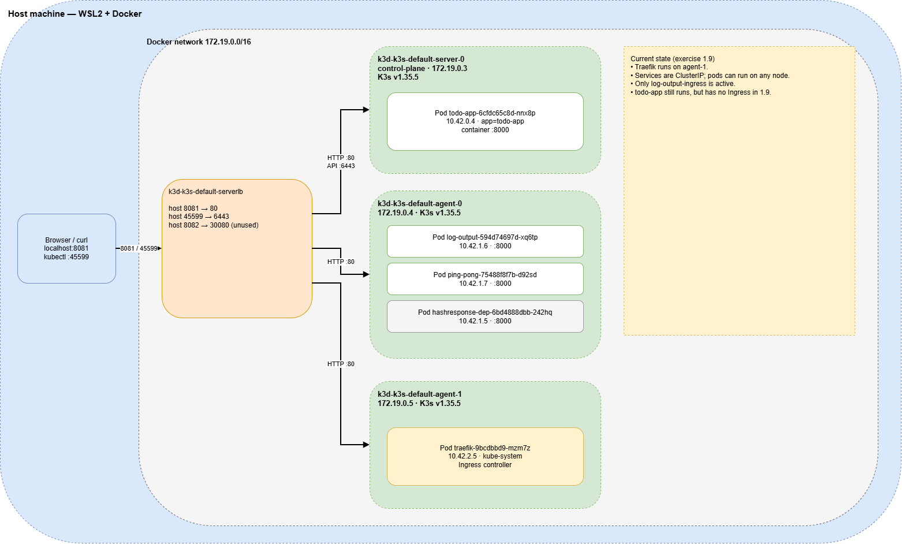
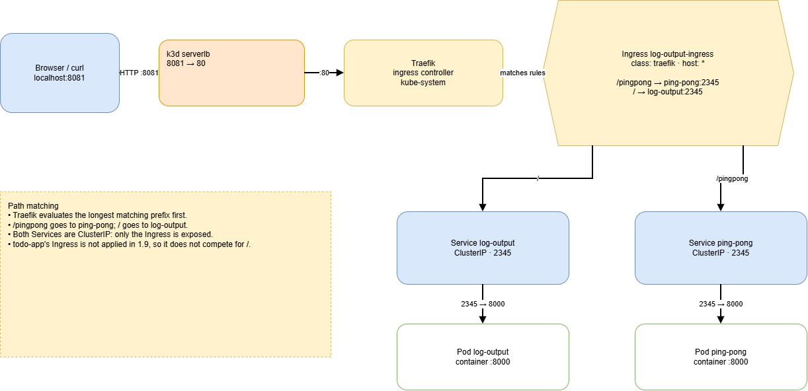
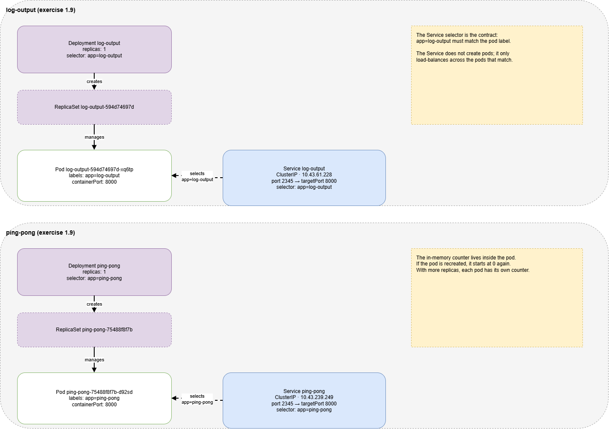

# DevOps with Kubernetes — Course Exercises

My solutions for the [DevOps with Kubernetes](https://devopswithkubernetes.com/) course from the University of Helsinki.

Every exercise is developed incrementally and published as its own **GitHub release**, so the repository history doubles as a record of progress.

**[Browse all releases](https://github.com/nobodyh-ctrl/kubernetes-helsinki-course/releases)** · **[Latest: 1.9](https://github.com/nobodyh-ctrl/kubernetes-helsinki-course/tree/1.9)**

---

## Repository layout

```
.
├── log_output/      # 1.1 — Log output
│   └── manifests/   #      Declarative deployment (1.3)
├── todo-app/        # 1.2 — Todo application
│   └── manifests/   #      Declarative deployment (1.4)
├── ping-pong/       # 1.9 — Ping-pong
│   └── manifests/
├── docs/
│   └── diagrams/    # Draw.io sources and PNG exports
├── .gitignore
└── README.md
```

Each application lives in its own top-level directory, named after the app. Inside it you will find the source code, the `Dockerfile`, the Kubernetes manifests (from exercise 1.3 onwards), and a short `README.md` describing what was done and how to run it.

Directories are added as the course advances.

## Diagrams

The cluster state at the end of exercise 1.9 is documented with Draw.io diagrams. The PNG exports are shown below; the editable `.drawio` sources live in [`docs/diagrams/`](docs/diagrams/).

### Cluster topology

Host, k3d serverlb, the three K3s nodes, and where each pod is scheduled.

[](docs/diagrams/cluster-topology.drawio.png)

### Ingress routing

Request flow from `localhost:8081` through Traefik and the shared Ingress to the two Services and Pods.

[](docs/diagrams/ingress-routing.drawio.png)

### Workloads and Services

How each Deployment creates a ReplicaSet and Pod, and how the Service selector matches the pod labels.

[](docs/diagrams/workloads-and-services.drawio.png)

## Releases

Each completed exercise gets:

- One commit containing that exercise's files
- An annotated tag in the form `<part>.<exercise>` (e.g. `1.1`, `2.3`, `4.10`)
- A GitHub release using the exercise number as the title

This makes it easy to review a single exercise without digging through later changes:

```bash
git checkout 1.1     # inspect the repository at that exercise
```

The `main` branch always contains every exercise completed so far.

### Published releases

| Exercise | Topic | Code | Release |
| -------- | ----- | ---- | ------- |
| 1.1 | Log output | [1.1](https://github.com/nobodyh-ctrl/kubernetes-helsinki-course/tree/1.1) | [1.1](https://github.com/nobodyh-ctrl/kubernetes-helsinki-course/releases/tag/1.1) |
| 1.2 | Todo application | [1.2](https://github.com/nobodyh-ctrl/kubernetes-helsinki-course/tree/1.2) | [1.2](https://github.com/nobodyh-ctrl/kubernetes-helsinki-course/releases/tag/1.2) |
| 1.3 | Declarative deployment | [1.3](https://github.com/nobodyh-ctrl/kubernetes-helsinki-course/tree/1.3) | [1.3](https://github.com/nobodyh-ctrl/kubernetes-helsinki-course/releases/tag/1.3) |
| 1.4 | Todo application deployment | [1.4](https://github.com/nobodyh-ctrl/kubernetes-helsinki-course/tree/1.4) | [1.4](https://github.com/nobodyh-ctrl/kubernetes-helsinki-course/releases/tag/1.4) |
| 1.5 | HTML page and port-forward | [1.5](https://github.com/nobodyh-ctrl/kubernetes-helsinki-course/tree/1.5) | [1.5](https://github.com/nobodyh-ctrl/kubernetes-helsinki-course/releases/tag/1.5) |
| 1.6 | NodePort service | [1.6](https://github.com/nobodyh-ctrl/kubernetes-helsinki-course/tree/1.6) | [1.6](https://github.com/nobodyh-ctrl/kubernetes-helsinki-course/releases/tag/1.6) |
| 1.7 | Status endpoint and Ingress | [1.7](https://github.com/nobodyh-ctrl/kubernetes-helsinki-course/tree/1.7) | [1.7](https://github.com/nobodyh-ctrl/kubernetes-helsinki-course/releases/tag/1.7) |
| 1.8 | Todo app Ingress | [1.8](https://github.com/nobodyh-ctrl/kubernetes-helsinki-course/tree/1.8) | [1.8](https://github.com/nobodyh-ctrl/kubernetes-helsinki-course/releases/tag/1.8) |
| 1.9 | Ping-pong and shared Ingress | [1.9](https://github.com/nobodyh-ctrl/kubernetes-helsinki-course/tree/1.9) | [1.9](https://github.com/nobodyh-ctrl/kubernetes-helsinki-course/releases/tag/1.9) |

## Progress

| Part | Topic | Exercises | Status |
| ---- | ----- | --------- | ------ |
| 1 | Introduction to Kubernetes | 1.1 – 1.13 | 🚧 1.1 – 1.9 done |
| 2 | Deploying applications | 2.1 – 2.10 | ⏳ Pending |
| 3 | Managing deployments | 3.1 – 3.12 | ⏳ Pending |
| 4 | Applying Kubernetes | 4.1 – 4.10 | ⏳ Pending |
| 5 | Kubernetes in practice | 5.1 – ... | ⏳ Pending |

## Prerequisites

- [kubectl](https://kubernetes.io/docs/tasks/tools/)
- A local cluster: [k3d](https://k3d.io/) or [kind](https://kind.sigs.k8s.io/)
- [Docker](https://docs.docker.com/get-docker/)
- [Helm](https://helm.sh/) (from part 2 onwards)

## Notes

- Exercises follow the course order; solutions are my own unless stated otherwise.
- Manifests target a local k3d cluster unless an exercise requires a cloud provider.
- Older exercises may not be updated to the latest API versions — they reflect the state of the course at the time.
